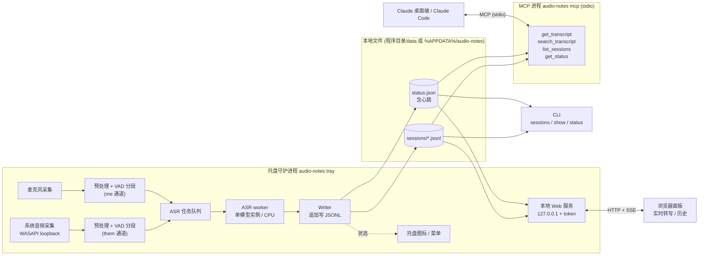
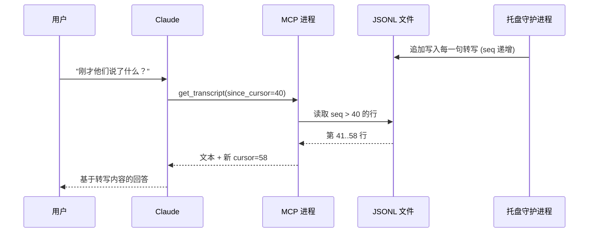
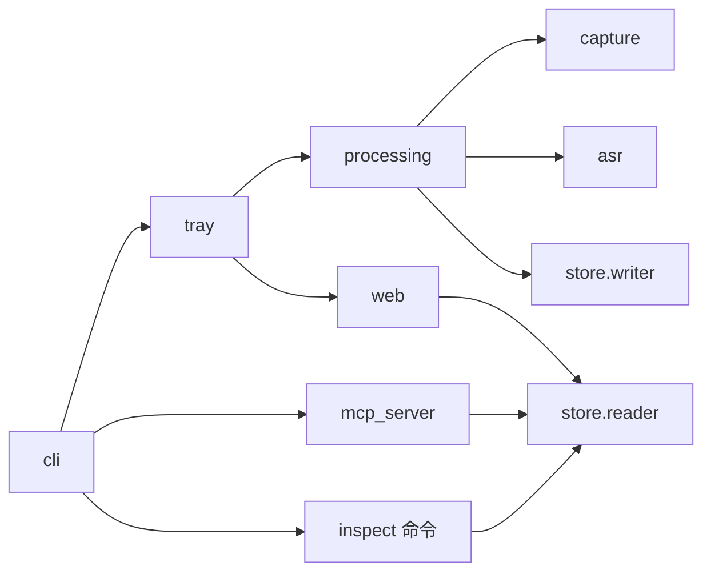
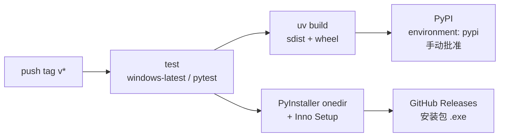

# audio-notes 技术架构

> 状态：草案。"文件共享 + stdio MCP"按此文档采用。数据目录：打包版放在程序目录旁的 `data` 文件夹，pip/uv 安装和源码运行放 `%APPDATA%\audio-notes`，可用 `AUDIO_NOTES_DATA_DIR` 覆盖（原因见第 6 节"数据目录"一行）。

## 1. 总体架构：两个进程，文件共享

MCP stdio server 由 Claude 客户端启动，生命周期归 Claude 管；采集和转写必须常驻。因此拆成两个进程：托盘守护进程是唯一写入者，MCP 进程和 CLI 只读。本地 Web 面板运行在守护进程内，同样只通过 `store.reader` 读取数据。



## 2. 转写流水线


## 3. 运行时序：Claude 按需拉取



## 4. 项目目录结构

```
audio-notes/
├── pyproject.toml              # uv + hatch-vcs；console script: audio-notes
├── uv.lock
├── README.md
├── .github/
│   └── workflows/
│       ├── ci.yml              # push / PR：Windows 上跑 pytest
│       └── release.yml         # v* 标签：构建 → PyPI（手动批准）+ 安装包
├── installer/                  # M6：PyInstaller spec、Inno Setup 脚本
├── docs/                       # 目标位置；当前两份文档仍在根目录
│   ├── REQUIREMENTS.md
│   └── ARCHITECTURE.md
├── src/
│   └── audio_notes/
│       ├── __init__.py
│       ├── __main__.py         # 仅 from .cli import app; app()
│       ├── config.py           # 默认值 + 环境变量（设备、模型档位、端口）
│       ├── paths.py            # 数据目录（环境变量 > 程序目录/data > %APPDATA%）、会话文件名
│       ├── recorder.py         # Recorder：串起采集 → 处理 → ASR → 存储；实现托盘的 RecorderController，`record` 与 `tray` 共用
│       │
│       ├── cli/                # 命令行入口（懒加载重依赖）
│       │   ├── __init__.py     # Typer app，注册子命令
│       │   ├── run.py          # tray / record / mcp
│       │   ├── inspect.py      # devices / sessions / show / status
│       │   └── setup.py        # setup claude
│       │
│       ├── capture/            # 抓音频
│       │   ├── base.py         # AudioSource 抽象接口
│       │   ├── win_wasapi.py   # MVP：loopback + 麦克风
│       │   └── mac_sck.py      # 第二阶段
│       │
│       ├── processing/         # 音频 → 语音段
│       │   ├── resample.py
│       │   ├── vad.py          # Silero 分段
│       │   └── runner.py       # 线程编排：采集 → VAD → ASR 队列 → 写入
│       │
│       ├── asr/                # 语音转文字
│       │   ├── base.py         # Transcriber 接口（便于测试替换）
│       │   └── faster_whisper_engine.py
│       │
│       ├── store/              # 转写数据，各进程的唯一共享层
│       │   ├── models.py       # Segment、SessionInfo
│       │   ├── writer.py       # 守护进程：追加写 + status.json 心跳
│       │   └── reader.py       # CLI / MCP / Web：cursor 读取、搜索、列会话
│       │
│       ├── tray/               # 托盘图标
│       │   ├── app.py          # pystray 主循环、菜单
│       │   ├── icons.py        # 空闲 / 录制中 / 出错
│       │   └── first_run.py    # 首次法律提示
│       │
│       ├── web/                # 本地 Web 面板
│       │   ├── server.py       # Starlette：路由、SSE、Host 校验、token
│       │   └── static/         # index.html / app.js / style.css（无构建步骤）
│       │
│       └── mcp_server.py       # FastMCP 工具，只依赖 store.reader
│
├── tests/
│   ├── fixtures/               # 几段短英文 wav
│   ├── test_store.py           # 并发读写、cursor、半行容错
│   ├── test_vad.py
│   ├── test_asr.py             # 喂 wav，断言文本含关键词
│   ├── test_cli.py             # 子命令冒烟测试
│   ├── test_web.py             # Host 校验、token、SSE 冒烟
│   ├── test_e2e_recorder.py    # FileSource + 假 ASR：说话人标签、错误处理（无需模型）
│   └── test_e2e_record_mcp.py  # `record` 转写 wav，再经真实 MCP stdio 读回（真实 tiny.en）
│
└── scripts/
    └── dump_devices.py         # M1 调试用
```

### 依赖方向（核心约束）



`mcp`、`sessions`、`show`、`status` 只碰 `store.reader`，不会导入 faster-whisper 和 PyAudio，启动快、内存小。`web` 也只经 `store.reader` 取数据，与转写流水线解耦；实时视图通过轮询 JSONL 末尾（数百毫秒）并以 SSE 推给浏览器。

## 5. 命令行（CLI）

```
audio-notes tray                 启动托盘守护进程（含 Web 面板）
audio-notes mcp                  启动 MCP server（stdio）
audio-notes record               无界面前台录制，Ctrl+C 结束
audio-notes devices              列出音频设备
audio-notes sessions             列出历史会话
audio-notes show [会话] -n 50 -f 查看转写，-f 持续跟随
audio-notes status               守护进程状态
audio-notes setup claude         输出 / 写入（--write）Claude 的 MCP 配置
```

`record` 与 `tray` 共用同一个 `processing/runner.py`，托盘只是可选外壳，因此转写阶段无需托盘即可端到端测试。

## 6. 技术选型

| 模块 | 选择 | 理由 | 备注 |
|---|---|---|---|
| 语言 / 项目管理 | Python 3.10+ / uv | 音频和 ASR 生态最成熟，MVP 最快 | 建议 3.11/3.12；3.13 的 wheel 待验证 |
| 系统音频采集 | PyAudioWPatch | PyAudio 的 fork，带 WASAPI loopback | M1 先验证可用性 |
| 麦克风采集 | PyAudioWPatch（同库） | 与 loopback 共用一套 API | 两路各自独立线程 |
| 重采样 | numpy / soxr（二选一） | 转 16kHz 单声道 | 以实测性能为准 |
| VAD | silero-vad（ONNX） | 轻量、准确，用于句子分段并抑制静音幻觉 | |
| ASR | faster-whisper（CTranslate2，int8） | pip 直接安装，无需编译，CPU 速度好 | MVP 用 `base.en` 或 `small.en`，设备和档位为配置项 |
| 托盘 | pystray + Pillow | 够用、轻量 | 占主线程，流水线放后台线程 |
| MCP | 官方 `mcp` Python SDK（FastMCP） | stdio，适配 Claude 桌面端和 Claude Code | |
| CLI | Typer | 类型注解即参数，帮助与补全好 | 命令内部懒加载重依赖 |
| Web 面板后端 | Starlette（+ uvicorn） | 轻量，SSE 简单；MCP SDK 大概率已带入，需确认 | 仅绑 127.0.0.1 |
| Web 面板前端 | 原生 HTML / JS（EventSource） | 无构建步骤，无 Node | 设置编辑留到第二阶段 |
| 存储 | JSONL + status.json | 单写者、多读者，无需 IPC 或数据库 | cursor 即 seq；读者需容忍末行不完整 |
| 并发模型 | threading | 采集与 ctranslate2 推理都会释放 GIL | 不需要 multiprocessing |
| 数据目录 | 打包版：程序目录旁的 `data`；pip/uv：`%APPDATA%\audio-notes\` | 转写属于用户数据，不混入代码仓库；打包版放程序旁，托盘、CLI、MCP 同目录自然一致，不需要用户设置环境变量 | 微软商店版应用（如 Claude 桌面端）对 AppData 有私有重定向，会让子进程看到不同的 `%APPDATA%`，所以打包版不用它 |
| 安装包（M6） | PyInstaller onedir + Inno Setup | 用户无需 Python；onedir 避免 onefile 每次解压拖慢 MCP 启动 | 未签名，SmartScreen 提示 |
| CI/CD | GitHub Actions + PyPI Trusted Publishing | 无需存 token；标签触发；PyPI 发布手动批准 | 版本号由 hatch-vcs 从标签生成 |
| macOS（后续） | ScreenCaptureKit | 采集层抽象接口，其余模块不变 | 需屏幕录制权限 |

## 7. 数据格式

目录：`<数据目录>\sessions\2026-11-16_14-30.jsonl`（数据目录见第 6 节"数据目录"一行）

```json
{"seq": 12, "t0": 83.2, "t1": 86.9, "speaker": "them", "text": "..."}
```

- `speaker`：`me`（麦克风）或 `them`（系统音频）。
- `t0` / `t1`：相对会话开始的秒数，两路使用同一单调时钟。
- `seq`：会话内递增，作为 `get_transcript` 的 cursor。

## 8. 安装与分发



- 开发者：`uv tool install audio-notes`（uv 自动管理 Python）。
- 普通用户：安装包，托盘、MCP、CLI 共用 `audio-notes.exe`。
- 模型首次运行时下载，不内置。
- Claude 配置使用 exe 的绝对路径，由 `setup claude` 或托盘"连接到 Claude"生成。

## 9. 已知风险与对策

| 风险 | 对策 |
|---|---|
| 外放时麦克风录到对方声音，同一句话出现 `them` 和 `me` 两条 | 建议戴耳机；之后在同一时间窗内对相似文本去重，丢弃 `me` 那条 |
| loopback 在无声播放时可能不产生帧 | 时间戳用墙钟，不靠帧数累加 |
| 默认音频设备切换（插拔耳机） | 监听设备变化或定期检查，自动重新绑定 |
| 两路并发时 CPU 占用叠加会议软件本身 | 单模型实例共用队列；M2 实测后选定 `base.en` 或 `small.en` |
| 读者读到写了一半的最后一行 | 解析失败时丢弃末行，下次再读 |
| 本地 Web 服务被其他网页探测（DNS rebinding） | 仅绑 127.0.0.1；校验 Host 头；不开 CORS；URL 带随机 token |
| 安装包体积大、未签名被拦截 | onedir；首批用户接受 SmartScreen 提示；之后再考虑签名 |
