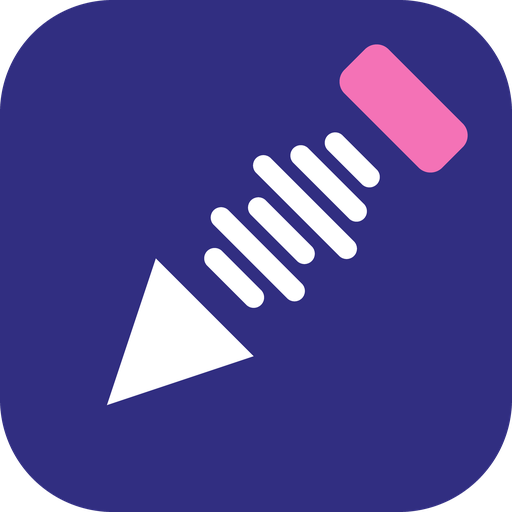

<div align="center">



# Audio Notes

### Your meetings, transcribed on your PC. Ask Claude about them.

**Open source. Fully local. Works offline. Secure by default.**<br>
System audio + microphone → Whisper on your CPU → Claude, over MCP. Audio never leaves your machine.

[](https://github.com/zohoMatt/audio-notes/releases/latest)
[](#quick-start)


</div>

---

Audio Notes is a lightweight Windows tray tool that captures **system audio** (what you hear) and
your **microphone**, transcribes both on your own CPU with
[faster-whisper](https://github.com/SYSTRAN/faster-whisper), and lets Claude read the transcript
through an [MCP](https://modelcontextprotocol.io) server. No cloud service, no account, no telemetry.

- **Open source.** MIT-licensed, built on open-source libraries. You can read exactly what it does
  with your audio.
- **Fully local.** Capture and transcription run on your PC. Audio is never written to disk or sent
  anywhere; transcripts are plain files on your disk.
- **Works offline.** After the speech model is downloaded once, recording and transcription need no
  internet connection.
- **Secure by default.** Claude connects over stdio, so there is no network port to reach. The
  panel listens on `127.0.0.1` only and requires a random token that changes on every run.

Transcript lines leave your PC only when you ask Claude about them: the lines Claude reads become
part of that conversation. See [What stays on your PC](#what-stays-on-your-pc) for the details.

Transcripts are stored in the `data` folder next to
the program when you use the installer or the packaged build (so the tray, the command line and the MCP
server always agree on where they are), and under `%APPDATA%\audio-notes\` when you install with
pip / uv. Set `AUDIO_NOTES_DATA_DIR` to put them somewhere else.

## Quick start

### 1. Install

Download `Audio-Notes-<version>-windows-x64-setup.exe` from the project's GitHub Releases page and run it
(no Python needed). It adds a Start Menu entry, connects Audio Notes to Claude Desktop, and can
optionally start with Windows and add the `audio-notes` command to your PATH.

> **Notes on the installer**
>
> The installer is **not code-signed**, so:
>
> - Windows SmartScreen will likely warn you. Click "More info", then "Run anyway".
> - Windows 11 with **Smart App Control** enabled may block unsigned programs outright, with no
>   override. In that case install with uv instead (below).
> - Antivirus products occasionally flag PyInstaller-built programs as false positives.
> - To verify your download, compare its SHA256 (`Get-FileHash .\Audio-Notes-<version>-windows-x64-setup.exe`)
>   with the hash printed in the release notes on the GitHub Releases page.
>
> **Alternative: uv (developers).** Not affected by any of the above:
>
> ```powershell
> uv tool install audio-notes
> audio-notes --version
> ```
>
> Install [uv](https://docs.astral.sh/uv/) first if you don't have it. uv manages Python for you.
> With uv, connect to Claude yourself (see [Connect to Claude](#connect-to-claude)).

#### macOS (Apple Silicon, macOS 14.2 or later)

Audio Notes lives in the menu bar (top right) and has no Dock icon. Two ways to install:

- **App (DMG, from the next release on).** Download `Audio-Notes-<version>-macos-arm64.dmg` from GitHub Releases and drag
  Audio Notes into Applications. Open it from there, not from the disk image. The app is not
  yet notarized, so macOS blocks the first launch: open System Settings > Privacy & Security and
  click **Open Anyway**.
- **uv.** `uv tool install git+https://github.com/zohoMatt/audio-notes` (builds the capture helper,
  so it needs the Command Line Tools: `xcode-select --install`), then run `audio-notes tray` in
  Terminal or iTerm.

macOS asks for Microphone and System Audio Recording permission. It grants them to the app you
started Audio Notes from: Audio Notes itself, or your terminal. **Start it from Terminal, iTerm or
the app, not from an IDE or from Claude:** macOS won't grant System Audio Recording there, and
Audio Notes then refuses to record instead of recording silence. `audio-notes devices` shows
which app the permissions go to.

### 2. Open the panel

Start **Audio Notes** from the Start Menu (or `audio-notes tray`). The icon
 appears in the
taskbar's notification area (click the `^` arrow if it is hidden). Click it to open the Audio
Notes panel, a local page in your browser served from your own machine. Right-click the icon for
the full menu.

### 3. Start recording

Click **Start recording** in the panel (or in the tray menu). The speech model (`base.en` by
default) is **downloaded once on first use** and cached; after that everything works offline.
The tray shows a "downloading" state while this happens. Set `AUDIO_NOTES_MODEL` to pick another
faster-whisper model (for example `small.en`).

### 4. Ask Claude

In Claude Desktop, click **+** in the message box, open **Connectors**, and make sure
**Audio Notes** is turned on. Then just ask, for example:

- "Summarize the last 10 minutes of the meeting."
- "What action items have been assigned to me so far?"
- "What did they say about the budget?"
- "List my past sessions and summarize yesterday's call."

The first time Claude uses an Audio Notes tool it asks for permission. Click **Allow** (or
**Always allow** so it doesn't ask again).

## Connect to Claude

With the Windows installer there is nothing to do: the "Connect to Claude Desktop" option is
ticked by default and adds audio-notes to Claude Desktop's config during setup. Restart Claude
Desktop afterwards. If you skipped it, or installed Claude Desktop later, use **Connect to Claude**
in the tray menu. Uninstalling does not touch Claude's config; remove the `audio-notes` entry from
`%APPDATA%\Claude\claude_desktop_config.json` yourself if you want it gone.

Advanced / `uv` installs, from the command line:

```powershell
audio-notes setup claude                 # prints the config / `claude mcp add` command
audio-notes setup claude --write         # merges it into Claude Desktop's config (asks first)
audio-notes setup claude --write --yes   # same, without asking (exit code 3: Claude Desktop not installed)
```

The configuration uses the absolute path to the `audio-notes` executable, so it works even when
Claude's child processes have an incomplete PATH. **Quit Claude Desktop completely (also from the
tray) before running `--write`, then start it again**: it rewrites its config file on exit and would
erase the entry. The Microsoft Store build keeps its config under
`%LOCALAPPDATA%\Claude-Data\claude_<id>\`; the command finds it automatically.

## Usage

Claude gets four tools: `get_transcript`, `search_transcript`, `list_sessions`, `get_status`.

Command line:

| Command | What it does |
|---|---|
| `audio-notes tray` | Start the tray daemon |
| `audio-notes record` | Record without UI; Ctrl+C to stop |
| `audio-notes devices` | List audio devices |
| `audio-notes sessions` | List past sessions |
| `audio-notes show [-n N] [-f]` | Show a transcript, `-f` to follow |
| `audio-notes status` | Is the daemon running, current session |
| `audio-notes mcp` | Run the MCP server over stdio (Claude launches this) |
| `audio-notes setup claude` | Print or write Claude's MCP config |

## What stays on your PC

- **Audio** is captured and transcribed on your CPU, and is never written to disk or sent anywhere.
- **Transcripts** are plain files on your disk (see above for where).
- **The panel** is served on `127.0.0.1` only, so other computers on your network can't open it.
- **Claude** talks to Audio Notes over stdio: Claude Desktop starts the `audio-notes` program on
  your PC, with no network port and no server in between. When you ask a question, the transcript
  lines Claude reads become part of that conversation and are sent to Anthropic like anything else
  you type to Claude. Nothing is sent until you ask.
- **The network** is used to download the speech model from Hugging Face on first use. When the
  model is loaded later, the download library still checks Hugging Face for a newer copy if you
  are online, and falls back to the cached model if you are not. There is no telemetry and no
  account.

## Legal notice: recording other people

Recording and transcribing conversations may require the consent of everyone involved, and the
rules differ by country and state (some require all parties to consent). You are solely
responsible for complying with the laws that apply to you and for telling participants when you
record meetings or calls. Do not use this tool to record people without their knowledge where the
law forbids it.

## Known limitations

- **Headphones recommended.** With speakers, the microphone can pick up the system audio again, so
  the same speech may appear twice (once as "them", once as "me"). Some laptop microphones with
  built-in echo cancellation reduce this, but don't count on it.
- Applications that open the audio device in **WASAPI exclusive mode** bypass the shared mixer;
  their audio is **not captured**.
- Windows and macOS (Apple Silicon, 14.2+). Intel Macs and Linux are not supported.
- The Windows installer is unsigned; the macOS app is not yet notarized.
- macOS: System Audio Recording can't be granted when Audio Notes is started from an IDE or from
  Claude; start it from a terminal or the app.

## Development

```powershell
uv sync
uv run pytest
```

`uv sync` uses Python 3.12, pinned in `.python-version` (the version the macOS CI job runs).
Installing with `uv tool install` works with any Python from 3.10 to 3.14.

**macOS: keep the virtual environment out of iCloud.** If the checkout is in `~/Documents` or
`~/Desktop` with iCloud Drive's "Desktop & Documents" sync on, iCloud marks `.venv` as hidden a
few seconds after it is created, and Python skips hidden `.pth` files. The editable install then
stops working: subprocesses and the MCP / end-to-end tests fail with
`No module named 'audio_notes'` (`ls -lO .venv/lib/python*/site-packages/*.pth` shows `hidden`).
Clone the repository somewhere iCloud doesn't sync, or keep the environment elsewhere, for example
in `~/.zshrc`:

```bash
export UV_PROJECT_ENVIRONMENT="$HOME/.venvs/audio-notes"
```

`chflags -R nohidden .venv` fixes a broken environment until iCloud hides it again.

Releasing: see [installer/RELEASING.md](installer/RELEASING.md).

### Running from source

Everything runs from the repository without building or installing the app:

```powershell
uv run audio-notes tray              # tray icon + web panel
uv run audio-notes tray --no-tray    # web panel only (real recorder); prints the panel URL, Ctrl+C stops
uv run audio-notes record --no-mic   # record system audio without any UI; Ctrl+C stops
uv run audio-notes sessions          # then: show, status
```

Run the whole pipeline without speakers or a microphone, from the test recordings:

```powershell
uv run audio-notes record --them-file tests/fixtures/them_budget.wav --me-file tests/fixtures/me_question.wav --fast
```

Point Claude Code at the source tree instead of an installed build (restart the Claude Code
session to pick up code changes):

```powershell
claude mcp add audio-notes -- uv --directory D:\path\to\audio-notes run audio-notes mcp
```

`tray --no-tray` and `record` skip the first-run recording notice. The demos in
[scripts/demos](scripts/demos/README.md) show single modules with fake data in a temporary folder;
`$env:DEMO_NO_TRAY=1; uv run python scripts/demos/tray_web_demo.py` runs the panel with a
simulated conversation.

Environment variables that help while developing:

| Variable | Effect |
|---|---|
| `AUDIO_NOTES_DATA_DIR` | Keep transcripts in another folder, away from your real ones |
| `AUDIO_NOTES_WEB_PORT` | Panel port (default 8765); lets a source run sit next to an installed one |
| `AUDIO_NOTES_MODEL` | ASR model, e.g. `tiny.en` for faster downloads and transcription |
| `AUDIO_NOTES_VAD_SILENCE_MS`, `AUDIO_NOTES_VAD_MAX_S` | When a segment is cut and sent to ASR |
| `AUDIO_NOTES_CLAUDE_CONFIG` | Claude Desktop config file used by `setup claude --write` and `clean` |

### Clean up after local testing

Testing the installer and "Connect to Claude" leaves entries and backups behind. To remove them,
quit Claude Desktop completely (also from the tray; it rewrites its config when it exits), then run
from the repository:

```powershell
uv run audio-notes clean --dry-run     # show what would be removed
uv run audio-notes clean --uninstall   # remove it, and uninstall the installed app silently
```

This removes the Audio Notes entry from every Claude Desktop config, the
`claude_desktop_config.json.bak-*` backups made by our connect step, and the Claude Code
registrations (user scope, every project's local scope, project `.mcp.json`). `--purge-data` also
deletes the transcripts; `--keep-backups` keeps the backups; `-y` skips the confirmation. If Claude
Desktop is still running, its config is skipped and the rest is cleaned. Restart Claude Code
sessions afterwards.
