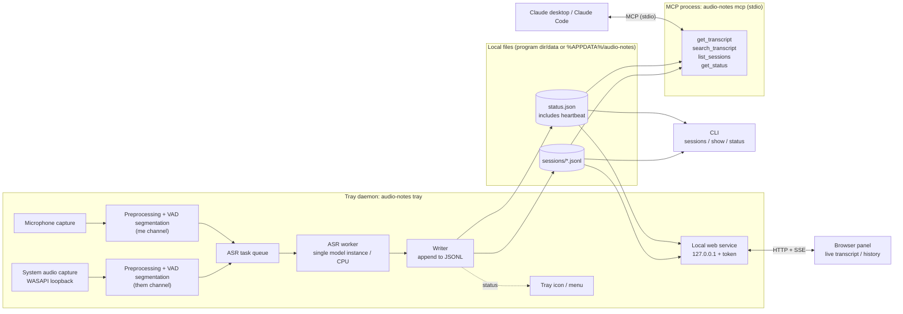
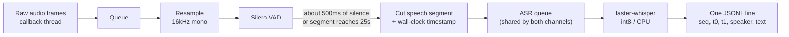
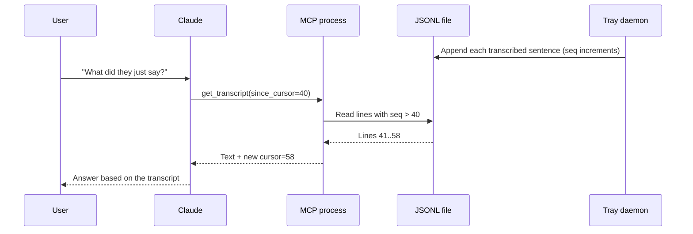
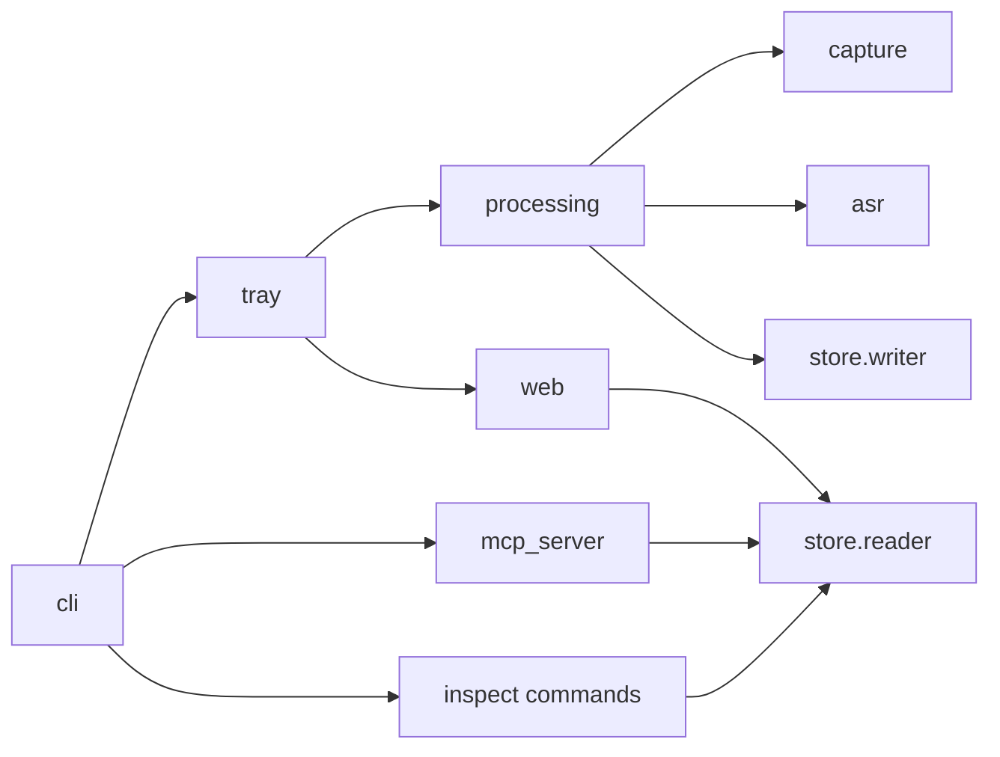
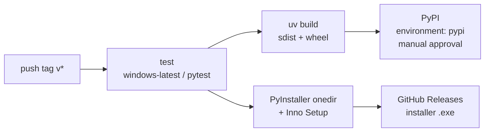

# audio-notes Technical Architecture

> Status: draft. "File sharing + stdio MCP" is adopted as described in this document. Data directory: the packaged build uses a `data` folder next to the program directory; pip/uv installs and source runs use `%APPDATA%\audio-notes`. `AUDIO_NOTES_DATA_DIR` overrides both (see the "Data directory" row in section 6 for why).

## 1. Overall architecture: two processes, shared files

The Claude client starts the MCP stdio server, and Claude owns its lifecycle. Capture and transcription must run continuously. So the work is split into two processes. The tray daemon is the only writer. The MCP process and the CLI only read. The local web panel runs inside the daemon and also reads data only through `store.reader`.



## 2. Transcription pipeline



## 3. Runtime sequence: Claude pulls on demand



## 4. Project directory layout

```
audio-notes/
├── pyproject.toml              # uv + hatch-vcs; console script: audio-notes
├── uv.lock
├── README.md
├── .github/
│   └── workflows/
│       ├── ci.yml              # push / PR: run pytest on Windows
│       └── release.yml         # v* tag: build → PyPI (manual approval) + installer
├── installer/                  # M6: PyInstaller spec, Inno Setup script
├── docs/                       # Target location; the two docs are still in the repo root for now
│   ├── REQUIREMENTS.md
│   └── ARCHITECTURE.md
├── src/
│   └── audio_notes/
│       ├── __init__.py
│       ├── __main__.py         # only: from .cli import app; app()
│       ├── config.py           # Defaults + environment variables (devices, model tier, port)
│       ├── paths.py            # Data directory (env var > program dir/data > %APPDATA%), session file names
│       ├── recorder.py         # Recorder: wires capture → processing → ASR → store; implements the tray's RecorderController; shared by `record` and `tray`
│       │
│       ├── cli/                # Command-line entry (lazy-loads heavy dependencies)
│       │   ├── __init__.py     # Typer app, registers subcommands
│       │   ├── run.py          # tray / record / mcp
│       │   ├── inspect.py      # devices / sessions / show / status
│       │   └── setup.py        # setup claude
│       │
│       ├── capture/            # Audio capture
│       │   ├── base.py         # AudioSource abstract interface
│       │   ├── win_wasapi.py   # MVP: loopback + microphone; watchdog detects lost devices / default device changes
│       │   ├── win_endpoints.py # Uses Core Audio to get the current default device id (PortAudio does not refresh its device list)
│       │   └── mac_tap.py      # macOS: manages the Swift helper subprocess (tap = system audio, mic = microphone); see MACOS.md
│       │
│       ├── processing/         # Audio → speech segments
│       │   ├── resample.py
│       │   ├── vad.py          # Silero segmentation
│       │   └── runner.py       # Thread orchestration: capture → VAD → ASR queue → write
│       │
│       ├── asr/                # Speech to text
│       │   ├── base.py         # Transcriber interface (easy to swap in tests)
│       │   └── faster_whisper_engine.py
│       │
│       ├── store/              # Transcript data; the only layer shared across processes
│       │   ├── models.py       # Segment, SessionInfo
│       │   ├── writer.py       # Daemon: appends to the session JSONL (a new session within the same second gets a -2 suffix)
│       │   ├── status.py       # status.json heartbeat; owned by the daemon for its whole lifetime (beats even when idle)
│       │   ├── reader.py       # CLI / MCP / Web: incremental reads by byte offset, search, list sessions
│       │   └── follow.py       # Follows the latest session (no lost lines on switch to a new session) + cursor with session id
│       │
│       ├── tray/               # Tray icon / mac menu bar
│       │   ├── app.py          # TrayApp: actions and state (platform-independent)
│       │   ├── backend.py      # TrayBackend interface; pystray_backend.py (Windows), mac_statusbar.py + mac_menu.py (macOS)
│       │   ├── icons.py        # App icon + idle / recording / error / downloading badges (installer/make_icon.py generates the .ico)
│       │   └── first_run.py    # First-run legal notice
│       │
│       ├── web/                # Local web panel
│       │   ├── server.py       # Starlette: routes, SSE, Host check, token
│       │   └── static/         # index.html / app.js / style.css (no build step)
│       │
│       └── mcp_server.py       # FastMCP tools; depends only on store.reader
│
├── tests/
│   ├── fixtures/               # A few short English wav files
│   ├── test_store.py           # Concurrent read/write, cursor, partial-line tolerance
│   ├── test_vad.py
│   ├── test_asr.py             # Feed wav, assert the text contains keywords
│   ├── test_cli.py             # Subcommand smoke tests
│   ├── test_web.py             # Host check, token, SSE smoke test
│   ├── test_e2e_recorder.py    # FileSource + fake ASR: speaker labels, error handling (no model needed)
│   └── test_e2e_record_mcp.py  # `record` transcribes a wav, then reads it back through real MCP stdio (real tiny.en)
│
└── scripts/
    └── dump_devices.py         # For M1 debugging
```

### Dependency direction (core constraint)



`mcp`, `sessions`, `show` and `status` only touch `store.reader`. They do not import faster-whisper or PyAudio, so they start fast and use little memory. `web` also gets data only through `store.reader`, so it is decoupled from the transcription pipeline. The live view polls the end of the JSONL (every few hundred milliseconds) and pushes to the browser over SSE.

## 5. Command line (CLI)

```
audio-notes tray                 Start the tray daemon (includes the web panel)
audio-notes mcp                  Start the MCP server (stdio)
audio-notes record               Headless foreground recording; Ctrl+C to stop
audio-notes devices              List audio devices
audio-notes sessions             List past sessions
audio-notes show [session] -n 50 -f View a transcript; -f keeps following
audio-notes status               Daemon status
audio-notes setup claude         Print / write (--write) Claude's MCP config
```

`record` and `tray` share the same `processing/runner.py`. The tray is only an optional shell, so the transcription stage can be tested end to end without the tray.

## 6. Technology choices

| Module | Choice | Reason | Notes |
|---|---|---|---|
| Language / project management | Python 3.10+ / uv | Most mature audio and ASR ecosystem; fastest path to MVP | 3.11/3.12 recommended; 3.13 wheels not yet verified |
| System audio capture | PyAudioWPatch | Fork of PyAudio with WASAPI loopback | Verify it works in M1 first |
| Microphone capture | PyAudioWPatch (same library) | Same API as loopback | Each channel has its own thread |
| Resampling | numpy / soxr (pick one) | Convert to 16kHz mono | Decide by measured performance |
| VAD | silero-vad (ONNX) | Light and accurate; used for sentence segmentation and to suppress hallucinations on silence | |
| ASR | faster-whisper (CTranslate2, int8) | Installs with pip, no compiling, good CPU speed | MVP uses `base.en` or `small.en`; device and tier are configurable |
| Tray | pystray + Pillow | Good enough and light | Takes the main thread; the pipeline runs in background threads |
| MCP | Official `mcp` Python SDK (FastMCP) | stdio; works with Claude desktop and Claude Code | |
| CLI | Typer | Type hints become arguments; good help and completion | Commands lazy-load heavy dependencies internally |
| Web panel backend | Starlette (+ uvicorn) | Light; SSE is simple; probably already pulled in by the MCP SDK, needs confirming | Binds only to 127.0.0.1 |
| Web panel frontend | Plain HTML / JS (EventSource) | No build step, no Node | Settings editing deferred to phase two |
| Storage | JSONL + status.json | Single writer, many readers; no IPC or database needed | The cursor is the seq; readers must tolerate an incomplete last line |
| Concurrency model | threading | Both capture and ctranslate2 inference release the GIL | No need for multiprocessing |
| Data directory | Packaged build: `data` next to the program directory; pip/uv: `%APPDATA%\audio-notes\` | Transcripts are user data and do not belong in the code repo. The packaged build keeps them next to the program, so the tray, CLI and MCP naturally share one directory and the user does not need to set environment variables | Microsoft Store apps (such as Claude desktop) privately redirect AppData, so child processes see a different `%APPDATA%`. That is why the packaged build does not use it |
| Installer (M6) | PyInstaller onedir + Inno Setup | Users need no Python; onedir avoids onefile's unpacking on every launch, which would slow MCP startup | Unsigned; SmartScreen warning |
| CI/CD | GitHub Actions + PyPI Trusted Publishing | No stored token; triggered by tags; PyPI release needs manual approval | Version number generated from the tag by hatch-vcs |
| macOS | Core Audio Process Tap (Swift helper `macos/capture`) + PyObjC NSStatusItem | Capture layer behind an abstract interface; other modules unchanged | 14.2+; needs only the "system audio recording only" permission; see MACOS.md |

## 7. Data format

Location: `<data directory>\sessions\2026-11-16_14-30.jsonl` (see the "Data directory" row in section 6 for the data directory)

```json
{"seq": 12, "t0": 83.2, "t1": 86.9, "speaker": "them", "text": "..."}
```

- `speaker`: `me` (microphone) or `them` (system audio).
- `t0` / `t1`: seconds since the session started. Both channels use the same monotonic clock.
- `seq`: increments within a session. Used as the cursor for `get_transcript`.

## 8. Installation and distribution



- Developers: `uv tool install audio-notes` (uv manages Python automatically).
- Regular users: the installer. The tray, MCP and CLI share `audio-notes.exe`.
- Models are downloaded on first run, not bundled.
- The Claude config uses the absolute path of the exe. It is generated by `setup claude` or by the tray's "Connect to Claude" item.

## 9. Known risks and mitigations

| Risk | Mitigation |
|---|---|
| With speakers on, the microphone picks up the other side, so the same sentence appears twice, as `them` and as `me` | Recommend headphones; later, dedupe similar text within the same time window and drop the `me` entry |
| Loopback may produce no frames when nothing is playing | Use wall-clock timestamps instead of summing frame counts |
| Default audio device changes (headphones plugged in or out) | Each channel's watchdog checks every second whether its stream is alive and whether the Windows default device id has changed. On a change, the Recorder stops all streams and reopens them (PortAudio only rescans devices when no stream is open). If reopening fails, it shows an error and retries every 3 seconds |
| With both channels running, CPU use adds to the meeting software's own load | One model instance with a shared queue; choose `base.en` or `small.en` after measuring in M2 |
| A reader sees a half-written last line | On a parse failure, drop the last line and read it again next time |
| Other web pages probe the local web service (DNS rebinding) | Bind only to 127.0.0.1; check the Host header; no CORS; random token in the URL |
| Large installer; unsigned, so it gets blocked | onedir; early users accept the SmartScreen warning; consider signing later |
