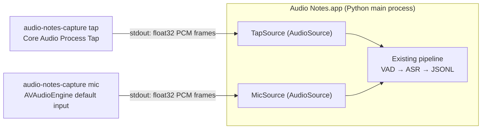
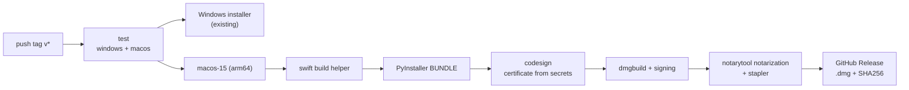

# macOS version: packaging and behavior design

> Status (2026-11-18): M-mac-1 (capture) and M-mac-2 (menu bar) have been verified and fixed on a real machine (macOS 26.6, Apple Silicon). See section 10.5 for the results. M-mac-3 (.app + ad-hoc signed DMG) builds locally. Its CI job is written but has not yet run on a tag. M-mac-4 (Developer ID signing and notarization) is waiting on a certificate. Details marked **[to be verified]** earlier in this document get their verdict in section 10.5 where they have been verified.
> Goal: no App Store. Users download the DMG from GitHub Releases, drag the app into "Applications", and it works. The menu bar icon in the top-right corner is the counterpart of the Windows tray icon.

## 1. Summary of decisions

| Item | Recommendation | Reason |
|---|---|---|
| Minimum system | **macOS 14.2+, Apple Silicon (arm64) only** | Core Audio Process Tap only exists from 14.2. An Intel build would need an x86_64/universal2 wheel for every dependency, for little gain |
| System audio capture | **Core Audio Process Tap** (not ScreenCaptureKit) | Needs only the "System Audio Recording Only" permission. No screen recording prompt, and no Sequoia "re-confirm monthly" prompt |
| Capture implementation | **A small Swift command-line helper**, sending PCM to Python over stdout | Real-time audio callbacks never enter Python or the GIL. Device change notifications are easy to handle in Swift. The Python side is still one `AudioSource` |
| Menu bar icon | **NSStatusItem written directly with PyObjC**, reusing the existing `TrayApp` logic | pystray on mac cannot set a template image (it shows as a colored square on light and dark menu bars) and does not support notifications |
| App form | `Audio Notes.app`, `LSUIElement=1` (no Dock icon) | The convention for menu bar tools |
| Packaging | **PyInstaller `BUNDLE`** (same approach as the existing spec) | Shares one set of dependency collection logic with Windows |
| Installer | **Signed and notarized DMG**, drag to Applications | The standard approach for menu bar tools. No .pkg needed (no system-level components are installed) |
| Signing | **Developer ID (Apple Developer Program, yearly fee) + notarytool notarization** | See section 5: not signing costs far more on mac than on Windows |
| Data directory | `~/Library/Application Support/Audio Notes/` | Cannot live inside the .app (it would break the signature and be lost on update) |
| Auto-update | v1: "Check for Updates…" in the menu opens the Releases page. Move to Sparkle 2 later | Sparkle is the de facto standard for non-App Store mac apps, but wiring it into a PyInstaller app takes extra work |
| Launch at login | **Not done** (also removed on Windows) | The product is local and offline, and runs only when the user opens it. A recording tool that starts itself at boot makes people uneasy |

## 2. Menu bar behavior

### 2.1 Icon

The menu bar icon is a **monochrome template image** (black + transparent, `NSImage.setTemplate_(True)`). The system adapts it automatically to light, dark and tinted menu bars. The current colored rounded square is used only for the app icon and the DMG, not in the menu bar.

- Size: 18×18 pt, exported at 1x/2x (18 px / 36 px).
- Glyph: keep the pencil whose body is a sound wave. Drop the background square and keep only the lines.

| State | Menu bar icon | Template image? |
|---|---|---|
| Idle | Pencil lines | Yes |
| Recording | Pencil + red dot at bottom right | **No** (the red must stay; this is common practice for recording tools) |
| Paused | Pencil + two vertical bars | Yes |
| Downloading model | Pencil + down arrow | Yes |
| Error / missing permission | Pencil + exclamation mark | Yes |

Optional while recording: show the elapsed time `12:34` to the right of the icon (`statusItem.button.title`, monospaced digit font). Off by default; toggled in the menu.

The system also shows its own indicators: the orange dot next to Control Center when the microphone is in use, and a purple indicator while recording system audio **[to be verified]**. Our red dot does not conflict with them.

### 2.2 Menu

Clicking the icon (left and right click behave the same, as is the mac convention) opens the menu. It uses mac title case and ellipsis conventions:

```
 ● Recording · 12:34                 ← gray status line, not clickable; shows the error reason on error
 ──────────────────────────────
 Pause Recording
 Stop Recording
 ✓ Include Microphone                 ← disabled while recording (same as Windows)
 ──────────────────────────────
 Open Panel…
 Show Transcripts in Finder
 Connect to Claude…
 ──────────────────────────────
 ⚠ Allow System Audio Recording…     ← only shown when the permission is missing; opens the matching System Settings page
 ──────────────────────────────
 Check for Updates…
 About Audio Notes
 Quit Audio Notes                ⌘Q
```

- Menu items can have small SF Symbols icons (`NSImage.imageWithSystemSymbolName_accessibilityDescription_`), such as `record.circle`, `pause.circle`, `folder`, `gearshape`. Optional; does not affect functionality.
- The panel still opens in the browser (the same local web panel, no changes). In a second phase, clicking the icon could open an `NSPopover` containing a WKWebView that loads a compact view of the same panel, with the menu on right click.

### 2.3 Notifications

Use `UNUserNotificationCenter` (requires a signed bundle). Send notifications only when: recording stops because of a device problem, a model download finishes, or "Connect to Claude" completes. The system asks for notification permission the first time one is sent. Denying it does not affect functionality (falls back to writing to the log).

### 2.4 First launch flow

Permissions are the most critical part of this app's experience on mac. Before each system prompt, show our own NSAlert explaining why the permission is needed:

1. **Location check**: if the app runs directly from the DMG (`/Volumes/...`) or has been moved by Gatekeeper path randomization (the path contains `AppTranslocation`), prompt "Please drag it to the Applications folder first" and offer a "Move and Reopen" button. Otherwise "Connect to Claude" would write a temporary path into the Claude config.
2. **Legal notice**: the existing `first_run` content, as an NSAlert.
3. **Microphone**: after the explanation, call `AVCaptureDevice.requestAccessForMediaType_` to trigger the system prompt.
4. **System audio**: after the explanation, the system prompts the first time a Process Tap is created.
5. At the end, show a notification or hint pointing at the menu bar icon: "Audio Notes is in the menu bar at the top right". LSUIElement apps have no Dock icon, so users can easily fail to find it the first time.

**Pitfall: when the system audio permission is denied, there is no error; you just get silence.** The public API cannot preflight this permission. Open-source examples (such as AudioCap) query it through a private TCC interface **[to be verified]**. Since we are not on the App Store, using a private API is acceptable. The helper checks once at startup. If denied: the icon changes to the exclamation mark, the menu shows "Allow System Audio Recording…", and clicking it opens the "Screen & System Audio Recording" page in System Settings (URL scheme `x-apple.systempreferences:com.apple.preference.security?Privacy_...`, exact anchor **[to be verified]**).

### 2.5 Preventing App Nap

App Nap throttles LSUIElement background apps. While recording, hold `NSProcessInfo.beginActivityWithOptions_reason_` (`NSActivityUserInitiated`, which also prevents idle system sleep). Release it when recording stops.

## 3. Audio capture



- **One Swift binary, two modes**. Each `AudioSource` starts one subprocess. Frame format: a small header (sample rate, frame count, host time) + float32 mono samples.
- Timestamps: the helper sends host time, and the Python side converts it to the session `origin`. As on Windows, wall-clock time is authoritative; we do not accumulate frame counts.
- **Device changes**: the helper watches for changes to the default input/output device and exits with an agreed exit code when one changes. The Python side maps this to `on_lost` and reuses the existing Recorder logic of "stop everything and reopen, retry every 3 seconds on failure". The Process Tap itself follows the whole system output, so switching headphones usually does not require a rebuild **[to be verified]**, but this path is kept anyway.
- **TCC attribution**: subprocesses launched from inside the .app count against Audio Notes, and the prompt says "Audio Notes would like to…". So `NSMicrophoneUsageDescription` and `NSAudioCaptureUsageDescription` go in the main app's Info.plist.
- Optional extra: enable `inputNode.setVoiceProcessingEnabled_` in mic mode (system echo cancellation). This can ease the problem of "me" also picking up the other side when using speakers. By default it lowers the volume of other audio; from macOS 14 the ducking is adjustable **[to be verified]**. Off by default; make it a setting after real-world testing.
- Alternative (not recommended): create the tap in-process with PyObjC. It works, but the IO callback enters Python on a real-time thread, which easily causes crackles and dropped frames, and is harder to debug.

On the Python side, add `capture/mac_tap.py` (two `AudioSource`s + subprocess management). `recorder.py` picks the implementation by `sys.platform`. On mac, the `devices` command lists input devices (the helper gets a `list` mode).

## 4. Packaging

### 4.1 Bundle structure

```
Audio Notes.app/
└── Contents/
    ├── Info.plist
    ├── MacOS/
    │   ├── Audio Notes            ← menu bar app (CFBundleExecutable), equivalent to Windows audio-notes-tray.exe
    │   ├── audio-notes            ← CLI / `mcp` stdio, equivalent to audio-notes.exe; the Claude config points to it
    │   └── audio-notes-capture    ← Swift capture helper
    ├── Frameworks/                ← Python and dynamic libraries collected by PyInstaller
    └── Resources/
        ├── AppIcon.icns
        └── audio_notes/web/static/...
```

PyInstaller's `BUNDLE` wraps a `COLLECT` containing two EXEs, the same idea as the MERGE in the existing Windows spec **[to be verified: BUNDLE support for multiple EXEs must be confirmed with a real build; if it fails, fall back to a single EXE and tell tray and CLI apart by argv[0] / arguments]**. Create `installer/audio-notes-mac.spec`, and extract the dependency collection into a shared function so the two specs do not drift apart.

Key Info.plist entries:

| Key | Value |
|---|---|
| `CFBundleIdentifier` | Reverse domain name, such as `io.github.zohomatt.audionotes` (never change it once set; TCC permissions are tied to it) |
| `CFBundleName` / `CFBundleDisplayName` | `Audio Notes` |
| `CFBundleShortVersionString` | `0.1.0` (converted from the hatch-vcs version; versions like `0.1.0a1` must be mapped to plain numbers; CFBundleVersion uses the build number) |
| `LSMinimumSystemVersion` | `14.2` |
| `LSUIElement` | `true` |
| `NSMicrophoneUsageDescription` | "Audio Notes transcribes your side of the conversation locally." |
| `NSAudioCaptureUsageDescription` | "Audio Notes transcribes what other participants say, on this Mac only." |

### 4.2 Signing and entitlements

Enable Hardened Runtime (required for notarization). Entitlements:

- `com.apple.security.device.audio-input` — required to use the microphone under Hardened Runtime.
- `com.apple.security.cs.allow-unsigned-executable-memory` — PyInstaller/ctranslate2/onnxruntime may need it. Leave it out at first; add it if the notarized build crashes at runtime **[to be verified]**.
- Do **not** enable App Sandbox: under the sandbox we cannot write Claude's config file. This is also one of the main reasons for not going on the App Store.

Signing order: sign from the inside out, one by one: `.so/.dylib` → helper → the two executables → the whole .app (`codesign --options runtime --timestamp`). Then sign the DMG as well, run `xcrun notarytool submit --wait`, then `xcrun stapler staple`.

### 4.3 DMG

- Use `dmgbuild` (Python; the config file can live in the repo and it runs easily in CI): the window holds the app icon and an "Applications" shortcut, with an arrow as the background image.
- File name: `Audio-Notes-<version>-macos-arm64.dmg`, with the SHA256 in the release notes (same as Windows).
- Later we can add our own Homebrew tap: `brew install --cask zohomatt/tap/audio-notes`. Very cheap, and developer users like it.

### 4.4 App icon

- Add mac output to the existing `make_icon.py`: draw on the Apple grid (1024 canvas, a rounded square of about 824 for the content, with margins all around) → PNGs at each size → `iconutil` produces the `.icns`.
- From macOS 26, system icons use the Liquid Glass style, and old icons that do not follow the guidelines are placed on a gray rounded backplate **[to be verified]**. If this looks bad, make a `.icon` with Xcode's Icon Composer and compile it with `actool` into `Assets.car` in Resources.

## 5. Why we recommend paid signing (the difference from Windows)

On Windows, not signing only triggers a SmartScreen warning. On mac, not signing causes three real problems:

1. **Opening it is a hassle**: from macOS 15, the right-click "Open" bypass is gone. Users must go to "System Settings → Privacy & Security → Open Anyway", or run `xattr -dr com.apple.quarantine` in the terminal.
2. **Every update requires granting permissions again**: TCC identifies apps by code signature, and an ad-hoc signature changes with every build. The microphone and system audio prompts reappear again and again, and stale "granted but not working" entries can even be left behind.
3. **Notifications** and other APIs that need a bundle identity are unreliable for unsigned apps.

So the recommendation: for yourself and a few technical friends, you can ship an ad-hoc signed build first (with the "Open Anyway" steps spelled out in the README). Before giving it to ordinary users, join the Apple Developer Program and get a Developer ID certificate. This is unrelated to whether the app goes on the App Store.

## 6. Changes to existing code

| Location | Change |
|---|---|
| `paths.py` | darwin packaged build: data goes to `~/Library/Application Support/Audio Notes`, no longer next to the program (Windows behavior unchanged). Logs go to `~/Library/Logs/Audio Notes` |
| `recorder.py` | Choose `win_wasapi` or `mac_tap` by platform |
| `capture/mac_tap.py` + `macos/capture/` (Swift source) | New; see section 3 |
| `tray/app.py` | `TrayApp` action logic unchanged. Extract the pystray wiring and add `tray/mac_statusbar.py` (NSStatusItem + NSMenu + template image). Make `_open_folder` cross-platform (`open` on mac) |
| `tray/icons.py` | Add `menubar_icon(state)`: monochrome template image + a red-dot version for recording |
| `tray/first_run.py` | NSAlert on mac; add the permission onboarding and the "move to Applications" check |
| `cli/setup.py` | `server_command()` returns `Contents/MacOS/audio-notes` inside the .app. Add a mac implementation of `claude_desktop_running()` (look up NSRunningApplication by bundle id). Refuse to write `/Volumes/` or AppTranslocation paths |
| `cli/clean.py`, `cli/devices.py` | Add darwin branches |
| `pyproject.toml` | darwin dependencies: `pyobjc-framework-Cocoa`, `pyobjc-framework-AVFoundation`, `pyobjc-framework-UserNotifications`; add macOS to classifiers |
| `installer/` | `audio-notes-mac.spec`, `entitlements.plist`, `dmg_settings.py`, `build_mac.sh` |
| `.github/workflows/` | ci: add `macos-15` running pytest; release: add an `installer-mac` job (see below) |

## 7. CI release flow



Required secrets: the Developer ID certificate `.p12` (base64) and its password, and an App Store Connect API Key (for notarization). The certificate is imported into a temporary keychain in CI. When the secrets are not configured, the job falls back to ad-hoc signing, skips notarization, and still produces a DMG (labeled "not notarized"). This way the pipeline works end to end before we have the certificate.

## 8. Phases

1. **M-mac-1 capture validation**: Swift helper + `mac_tap.py`; `audio-notes record` transcribes end to end on mac. Confirm the permission prompts, detection of silence after denial, and headphone switching.
2. **M-mac-2 menu bar**: NSStatusItem, template icon, menu, first-launch onboarding, App Nap.
3. **M-mac-3 packaging**: .app + ad-hoc signed DMG, CI job; Connect to Claude works on a real machine.
4. **M-mac-4 signing and notarization**: once we have a Developer ID, turn on signing and notarization in CI.
5. **Later**: Sparkle auto-update, a panel that pops up on icon click (NSPopover), Homebrew tap, and an evaluation of Metal-accelerated ASR on Apple Silicon (such as whisper.cpp / MLX).

## 9. Items that need manual testing (cannot be automated)

- The three permission prompts on first launch; the menu hint and the "go to Settings" jump after denial.
- How the menu bar icon looks on light, dark and wallpaper-tinted menu bars; the recording red dot.
- Recovery when plugging/unplugging headphones, switching AirPods, and switching the default input device.
- The "move to Applications" prompt when running directly from the DMG; the path written by Connect to Claude after moving.
- Claude Desktop can read transcripts after starting the MCP server; whether permissions survive an update to a new version (signed build).
- Recording state after closing the lid and after sleep/wake.

## 10. Implementation notes and real-machine verification checklist (M-mac-1 / M-mac-2)

> The code was first written on Windows and was verified item by item on a real machine on 2026-11-18 (results in 10.5). Unit tests use a fake helper process (`tests/fake_mac_helper.py`) to cover the frame format, exit codes, stop/reopen and the menu logic. The CI `test-macos` job (macos-15) compiles the Swift helper and runs all tests, but CI has no audio permissions and cannot actually record.

### 10.1 Current distribution

- Two ways: after `uv tool install`, run `audio-notes tray` (or `record`) in a terminal; or use the `Audio Notes.app` / DMG built by `installer/build_mac.sh` (for now only ad-hoc signed; on first open you must click "Open Anyway" in "System Settings → Privacy & Security").
- **Permissions are attributed to the "responsible app"** (TCC's responsible process), not to python or the helper. Launched from a terminal, they count against Terminal / iTerm. Launched from the .app, they count against Audio Notes. Switching to a different terminal app requires granting again.
- **Some launch methods cannot get the system audio permission**: when launched from Claude Code / Claude Desktop, an IDE or launchd, system audio stays undetermined and no prompt appears (or clicking "Allow" has no effect), so the Process Tap delivers only silence. This does not depend on whether the app's Info.plist has `NSAudioCaptureUsageDescription` (Terminal and iTerm both lack it yet can be granted; Claude.app has it yet cannot). So the helper's `tap` mode requests the permission once at startup. If it is still undetermined, it refuses with exit code 15 and names the responsible app (the `responsible` field of `permissions`, and "granted to" in `audio-notes devices`).
- No launch at login (on neither platform).
- Installation sources:
  - From source: `uv tool install git+https://github.com/zohoMatt/audio-notes`, or `uv tool install .` in a checkout. The Swift helper is compiled locally, which needs Xcode or the Command Line Tools (`xcode-select --install`).
  - PyPI: the `build-macos-wheel` job in `release.yml` builds a `py3-none-macosx_14_0_arm64` wheel (including the helper) and publishes it together with the pure Python wheel. pip/uv prefer it on mac. Not yet run on a real tag.
  - Development environment: if the checkout is in an iCloud-synced `~/Documents`, iCloud sets a hidden flag on `.venv`, and Python then skips its `.pth` (`No module named 'audio_notes'`). Use `UV_PROJECT_ENVIRONMENT` to put the venv elsewhere (see the Development section of the README).

### 10.2 Code structure

| Location | Contents |
|---|---|
| `macos/capture/` (SwiftPM) | Helper `audio-notes-capture`. Modes: `tap` (Process Tap + private aggregate device), `mic` (AVAudioEngine), `list` (device JSON), `permissions [--request]` (permission JSON; can trigger the system prompts first) |
| `macos/capture/Sources/AudioNotesCapture/Protocol.swift` | The authoritative definition of the frame format and exit codes; the Python side `capture/mac_tap.py` mirrors it |
| `hatch_build.py` | Build hook: only on macOS, runs `swift build -c release`, puts the helper into the wheel's `audio_notes/capture/bin/`, and tags the wheel `macosx_14_0_<arch>`. Editable installs (`uv sync`) only compile without copying; at runtime the helper is looked up in `macos/capture/.build/release/`. `AUDIO_NOTES_SKIP_HELPER_BUILD=1` skips it |
| `capture/mac_tap.py` | `TapSource` (them) / `MicSource` (me): one helper subprocess per source. Lookup order: `$AUDIO_NOTES_CAPTURE_HELPER` > inside the wheel > next to the packaged program > source tree build output |
| `recorder.py` | `default_sources()` picks the mac or Windows implementation by `sys.platform` |
| `tray/backend.py` | `TrayBackend` interface; `pystray_backend.py` (Windows, menu exactly as before) and `mac_statusbar.py` (NSStatusItem) |
| `tray/mac_menu.py` | Pure data model of the section 2.2 menu (testable on Windows) |
| `tray/icons.py` | `menubar_icon(state, scale, dark)`: 18 pt monochrome template image; while recording a non-template image (red dot), with the pencil drawn black or white according to the menu bar's light/dark mode |
| `paths.py` | mac: data in `~/Library/Application Support/Audio Notes`, logs in `~/Library/Logs/Audio Notes/audio-notes.log` |

Frame format: a 32-byte little-endian header (`magic` "ANCR"=ready / "ANCF"=audio, `sample_rate`, `count`, `flags`, `host_ns`, `sent_ns`) + float32 mono samples. Timestamps: Python takes the `time.monotonic()` at which it receives the frame and subtracts `sent_ns - host_ns` as measured by the helper itself (the delay from capture to write). The two processes do not need a shared clock.

Exit codes: 0 normal (stdin EOF / SIGTERM), 10 default device changed (for `tap` this also covers an output sample rate change), 11 device gone, 12 permission denied, 13 system older than 14.2, 14 no device, 15 system audio cannot be granted to the app that launched it (see 10.1). 10/11/other after startup → `on_lost`, reusing the Recorder's "stop everything and reopen, retry every 3 seconds on failure". 12 before startup → `CapturePermissionError`; the error text contains "System Audio Recording permission", and the menu uses it to show "Allow System Audio Recording…". 15 before startup is also a `CapturePermissionError`, but its text deliberately does not contain that keyword (going to System Settings would not help). Instead it tells the user to launch from Terminal or the .app.

### 10.3 Differences from the design above

- **Permission queries live in the Swift helper** (`permissions` mode; the microphone uses AVCaptureDevice; system audio uses the private TCC SPI `TCCAccessPreflight/TCCAccessRequest` + `kTCCServiceAudioCapture`, loaded with dlopen, returning unknown when symbols are missing). So Python depends only on `pyobjc-framework-Cocoa` and does not need the AVFoundation / UserNotifications PyObjC packages. pystray is no longer installed on mac.
- Notifications use `osascript display notification` (the UNUserNotificationCenter of 2.3 needs a signed bundle).
- First launch: legal notice (NSAlert) → permission explanation (NSAlert, explaining that permissions will show under the terminal's name) → `permissions --request` triggers the two system prompts in turn → notification "in the menu bar at the top right". Step 1 of 2.4 (location check when running from the DMG) is only half done: when running from a `/Volumes/` or AppTranslocation path, `setup claude --write` and the menu's Connect to Claude refuse to write and ask the user to drag the app into "Applications" first; there is no prompt at startup yet. When running as the .app, the permission explanation no longer mentions the terminal.
- The "recording duration next to the icon" of 2.1 and the SF Symbols of 2.2 are only partly done (menu items have SF Symbol icons; the status line has no timer).
- "Check for Updates…" shows a dialog suggesting `uv tool upgrade audio-notes`, with an option to open the Releases page.
- App Nap: the session holds `NSActivityUserInitiated` while capturing and releases it on pause/stop.

### 10.4 Real-machine verification checklist

Environment: Apple Silicon, macOS 14.2+ (ideally one machine with 14.x and one with 15.x/26), Xcode CLT, uv.

**A. Build (top risk: the Swift code has never been compiled)**
1. `swift build -c release --package-path macos/capture` passes. APIs written from memory that need checking: `CATapDescription(stereoGlobalTapButExcludeProcesses:)`, `muteBehavior`/`isPrivate`, `kAudioAggregateDevice*Key` / `kAudioSubTap*Key`, `kAudioTapPropertyFormat`, the closure signature of `AudioDeviceCreateIOProcIDWithBlock`, and the `@convention(c)` types of the TCC SPI.
2. In a checkout, `uv sync && uv run pytest` is all green (the editable install triggers the hatch hook to compile the helper).
3. `uv build --wheel`: the file name contains `macosx_14_0_arm64` and includes `audio_notes/capture/bin/audio-notes-capture`; after `uv tool install dist/*.whl` that file has the executable bit.
4. `audio-notes devices` lists output/input devices and both permission states.

**B. Capture (`audio-notes record`)**
5. First `audio-notes record --no-mic` while playing a video: the system audio permission prompt appears and **shows the terminal app's name**; after allowing, `them` gets transcripts.
6. `audio-notes record` (with microphone): the microphone permission prompt appears; `me` gets transcripts; when speaking and playing through speakers at the same time, the timestamps of the two streams line up (difference < 0.5 s).
7. **Deny system audio** (turn off the terminal's "System Audio Recording Only" in System Settings): `devices` shows `system audio recording denied`; `record` reports "System Audio Recording permission is off…" instead of silently recording silence. If it actually records silence: the return value convention of `TCCAccessPreflight` (0=allowed, 1=denied) is wrong or the SPI is unavailable; record the actual output of `permissions`.
8. Deny the microphone: recording continues normally (only them), with a warning in the log; the menu shows "Allow Microphone Access…".
9. Device changes (while recording): plug/unplug wired headphones, connect/disconnect AirPods, switch output in Control Center, switch the default input. The log should show "the default output/input device changed" → rebind within about 1–2 seconds, transcription continues, same session file. `pgrep -fl audio-notes-capture` shows only one process per stream. Confirm that `AVAudioEngineConfigurationChange` does not fire spuriously at startup and cause repeated restarts.
10. Both 44.1 kHz devices and Bluetooth headset microphones (HFP 16/24 kHz) transcribe.
11. After stop, pause/resume, Ctrl+C, and `kill -9` of the main process: no leftover helper processes (the helper exits on stdin EOF); no leftover aggregate device in "Audio MIDI Setup".
12. Recording state after closing the lid to sleep and waking; helper CPU usage (Activity Monitor).

**C. Menu bar (`audio-notes tray`)**
13. No Dock icon; on first launch, in order: legal notice → permission explanation → two system prompts → "in the menu bar" notification. The NSAlerts show the app icon and appear in front.
14. The icon is clear on light, dark and wallpaper-tinted menu bars (template image tinted correctly); red dot while recording; when switching light/dark while recording, the pencil changes color within about 0.5 seconds; the recording icon is still recognizable while the menu is open (highlighted state).
15. The menu matches 2.2 (no Open at Login); the status line is gray; "Include Microphone" is disabled while recording/paused; Quit shows ⌘Q.
16. Every item works: start/pause/resume/stop; Open Panel… opens the browser; Show Transcripts in Finder opens `~/Library/Application Support/Audio Notes/sessions`; the Connect to Claude… confirmation (switched from a background thread to the main thread to show it) writes the config, and while Claude Desktop is running it asks the user to quit it first (look up NSRunningApplication by bundle id `com.anthropic.claudefordesktop`, then check executable paths in `ps`; `pgrep -x Claude` cannot be used: BSD pgrep does not match its own ancestor processes, so when launched from inside Claude it cannot see it); About; Check for Updates….
17. "Allow System Audio Recording…" opens the "Screen & System Audio Recording" page (URL anchor `Privacy_ScreenCapture`, verified); "Allow Microphone Access…" opens the microphone page. After granting, without restarting Audio Notes, the next retry records sound.
18. App Nap: while recording, `pmset -g assertions` shows "Audio Notes is recording and transcribing"; it disappears after pause/stop.
19. The osascript notification on errors appears (shown as "Script Editor").
20. Both menu Quit and terminal Ctrl+C exit cleanly: the terminal returns to the prompt, the panel port is released, and `audio-notes status` shows offline.

**D. CLI / Claude**
21. `audio-notes setup claude --write` writes the resolved absolute path of `~/.local/bin/audio-notes` (do not run setup from a `.venv` inside iCloud; `setup claude` warns about this); Claude Desktop can read transcripts after starting the MCP server.
22. `audio-notes clean --purge-data` deletes the directories under Application Support and Logs; `--uninstall` suggests `uv tool uninstall audio-notes`.

**Known risks**: the IO callback allocates memory and writes to stdout through a queue (switch to a ring buffer if there are crackles or dropped frames); the TCC SPI may stop working in the future (it then degrades to "unknown", and silence cannot be told apart from no sound); whether TCC attribution is always the terminal (and not python or the helper) when running from a terminal needs confirmation.

### 10.5 Real-machine verification results (2026-11-18, macOS 26.6.2, Apple Silicon)

| Item | Result | Notes |
|---|---|---|
| A 1–4 Build | Pass | Swift 6.2.4 (Command Line Tools only); wheel tagged `macosx_14_0_arm64`, helper has the executable bit |
| B 5 System audio | Pass | Launched from Terminal: the prompt names Terminal; `them` is word-for-word correct |
| B 6 Two streams | Pass | `me` and `them` differ by 0.05–0.08 s |
| B 7 Deny system audio | Pass | `TCCAccessPreflight` 0=allowed, 1=denied, 2=undetermined; helper exits 12, `record` refuses to start |
| B 8 Deny microphone | Pass | Records only `them`, with a warning in the log |
| B 9 Device changes | Software switching passes | Rebinds in 1.1–1.7 s, same session file; wired headphones and AirPods not tested |
| B 10 Sample rate | Pass after fix | 44.1 kHz output was previously labeled 48 kHz (about 9% fast); Bluetooth HFP not tested |
| B 11 Exit | Pass | No leftover helper or aggregate device after stop, pause/resume, Ctrl+C, `kill -9`; `record` now also treats SIGTERM like Ctrl+C when shutting down |
| B 12 Sleep | Pass | Each helper uses 0.2–0.4% CPU; timestamps now use a clock that keeps counting across sleep; not retested on a real machine after the fix |
| C 13–20 Menu bar | Pass | Dialog icon and Connect to Claude fixed in two places; plain light/dark menu bars and switching light/dark while recording not tested; notifications show as "Script Editor" |
| D 21 Claude | Pass | Both Claude Desktop and Claude Code can call all four tools; config file permissions stay 600 |
| D 22 clean | Pass | Deletes the directories under Application Support and Logs |
| Packaging | Pass locally | Multiple executables inside the `.app` work; `codesign --verify` and `hdiutil verify` pass; signing fails inside an iCloud directory, so the build directory must be outside `~/Documents` |

`status` now shows offline immediately after a normal exit (`stopped` in `status.json`); it only waits for the heartbeat to expire after a crash.
