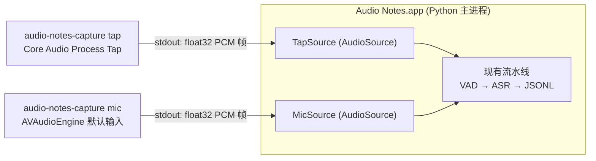
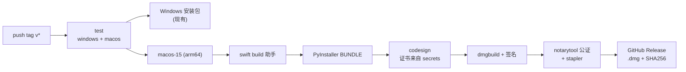

# macOS 版：打包与表现设计

> 状态：M-mac-1（采集）和 M-mac-2（菜单栏）已写好代码，**尚未在真机上运行过**，见第 10 节的实现说明和真机验证清单。打包（M-mac-3/4）未开始。标 **[待验证]** 的是凭记忆写的平台细节，实现前先在真机上确认。
> 目标：不上 App Store，从 GitHub Releases 下载 DMG，拖进"应用程序"即可用；右上角菜单栏图标对应 Windows 托盘。

## 1. 结论一览

| 项 | 推荐 | 理由 |
|---|---|---|
| 最低系统 | **macOS 14.2+，仅 Apple Silicon (arm64)** | 14.2 起才有 Core Audio Process Tap；Intel 版要求每个依赖都有 x86_64/universal2 wheel，收益小 |
| 系统音频采集 | **Core Audio Process Tap**（不是 ScreenCaptureKit） | 只需"仅系统音频录制"权限，不弹屏幕录制授权，也没有 Sequoia 的"每月再确认"提示 |
| 采集实现 | **一个小的 Swift 命令行助手**，PCM 走 stdout 给 Python | 实时音频回调不进 Python/GIL；设备切换通知在 Swift 里好处理；Python 侧仍是一个 `AudioSource` |
| 菜单栏图标 | **PyObjC 直接写 NSStatusItem**，复用现有 `TrayApp` 逻辑 | pystray 在 mac 上不能设模板图（深浅色菜单栏会显示成彩色方块）、不支持通知 |
| 应用形态 | `Audio Notes.app`，`LSUIElement=1`（无 Dock 图标） | 菜单栏工具的惯例 |
| 打包 | **PyInstaller `BUNDLE`**（沿用现有 spec 思路）| 和 Windows 共用一套依赖收集逻辑 |
| 安装包 | **签名 + 公证的 DMG**，拖到 Applications | 菜单栏工具的标准做法；不需要 .pkg（不装系统级组件） |
| 签名 | **Developer ID（Apple Developer Program，年费）+ notarytool 公证** | 见第 5 节：不签名在 mac 上代价远大于 Windows |
| 数据目录 | `~/Library/Application Support/Audio Notes/` | 不能放 .app 里（会破坏签名、更新即丢失） |
| 自动更新 | v1：菜单里"检查更新…"打开 Releases 页；之后上 Sparkle 2 | Sparkle 是非商店 mac 应用的事实标准，但接入 PyInstaller 应用要额外工作 |
| 开机启动 | **不做**（Windows 也已去掉） | 产品定位是本地、离线、用户主动打开才运行；录音工具开机自己跑起来让人不安 |

## 2. 菜单栏表现

### 2.1 图标

菜单栏图标用**单色模板图**（黑 + 透明，`NSImage.setTemplate_(True)`），系统自动适配浅色/深色/着色菜单栏。现在的彩色圆角方块只用于 App 图标和 DMG，不进菜单栏。

- 尺寸：18×18 pt，出 1x/2x（18 px / 36 px）。
- 字形：沿用"笔身是声波"的铅笔，去掉背景方块，只留线条。

| 状态 | 菜单栏图标 | 是否模板图 |
|---|---|---|
| 空闲 | 铅笔线条 | 是 |
| 录制中 | 铅笔 + 右下角红点 | **否**（红色要保留；这是录制类工具的通行做法） |
| 暂停 | 铅笔 + 两条竖线 | 是 |
| 下载模型 | 铅笔 + 向下箭头 | 是 |
| 出错 / 缺权限 | 铅笔 + 感叹号 | 是 |

录制中可选：图标右侧显示已录时长 `12:34`（`statusItem.button.title`，等宽数字字体）。默认关，设置在菜单里切换。

系统自己也会显示指示：用麦克风时控制中心旁的橙点，系统音频录制时的紫色指示 **[待验证]**。我们的红点和它们不冲突。

### 2.2 菜单

点击图标（左右键都一样，mac 惯例）弹出菜单。用 mac 的标题式大小写和省略号约定：

```
 ● Recording · 12:34                 ← 灰色状态行，不可点；出错时显示错误原因
 ──────────────────────────────
 Pause Recording
 Stop Recording
 ✓ Include Microphone                 ← 录制中禁用（与 Windows 一致）
 ──────────────────────────────
 Open Panel…
 Show Transcripts in Finder
 Connect to Claude…
 ──────────────────────────────
 ⚠ Allow System Audio Recording…     ← 只在缺权限时出现，打开系统设置对应页
 ──────────────────────────────
 Check for Updates…
 About Audio Notes
 Quit Audio Notes                ⌘Q
```

- 菜单项可配 SF Symbols 小图标（`NSImage.imageWithSystemSymbolName_accessibilityDescription_`），如 `record.circle`、`pause.circle`、`folder`、`gearshape`。可选，不影响功能。
- 面板仍在浏览器里打开（同一个本地 Web 面板，零改动）。第二阶段可以改成点击图标弹出 `NSPopover`，里面是 WKWebView 加载同一面板的紧凑视图；右键再出菜单。

### 2.3 通知

用 `UNUserNotificationCenter`（需要签名的 bundle）。只在这些时候发：录制因设备问题停止、模型下载完成、"Connect to Claude"完成。第一次发通知时系统会请求通知权限，拒绝了也不影响功能（回退到写日志）。

### 2.4 首次启动流程

mac 的权限是这个应用最关键的体验，系统弹窗前先用我们自己的 NSAlert 说明为什么要权限：

1. **位置检查**：如果是从 DMG 里直接运行（`/Volumes/...`）或被 Gatekeeper 路径随机化（路径含 `AppTranslocation`），提示"请先拖到'应用程序'文件夹"，提供"移动并重新打开"按钮。否则"Connect to Claude"会把一个临时路径写进 Claude 配置。
2. **法律提示**：现有 `first_run` 内容，换成 NSAlert。
3. **麦克风**：说明后调用 `AVCaptureDevice.requestAccessForMediaType_`，触发系统弹窗。
4. **系统音频**：说明后第一次创建 Process Tap 时系统弹窗。
5. 结束后弹一个指向菜单栏图标的通知/提示："Audio Notes 在右上角菜单栏"。LSUIElement 应用没有 Dock 图标，用户第一次很容易找不到它。

**坑：系统音频权限被拒时不会报错，而是只收到静音。** 公开 API 无法预检这个权限；开源示例（如 AudioCap）用私有的 TCC 接口查询 **[待验证]**。不上 App Store，用私有 API 可以接受。助手启动时查一次，拒绝则：图标变感叹号，菜单出现"Allow System Audio Recording…"，点了打开系统设置的"屏幕与系统音频录制"页（URL scheme `x-apple.systempreferences:com.apple.preference.security?Privacy_...`，具体锚点 **[待验证]**）。

### 2.5 防 App Nap

LSUIElement 后台应用会被 App Nap 降频。录制期间持有 `NSProcessInfo.beginActivityWithOptions_reason_`（`NSActivityUserInitiated`，含禁止系统空闲睡眠），停止录制时释放。

## 3. 音频采集



- **一个 Swift 二进制，两种模式**，每个 `AudioSource` 启一个子进程。帧格式：小头（采样率、帧数、主机时间）+ float32 单声道样本。
- 时间戳：助手发主机时间，Python 侧换算到会话的 `origin`；和 Windows 一样以墙钟为准，不靠帧数累加。
- **设备切换**：助手监听默认输入/输出设备变化，变化时以约定退出码退出；Python 侧映射成 `on_lost`，沿用现有 Recorder 的"全部停掉再重开、失败每 3 秒重试"逻辑。Process Tap 本身跟随整个系统输出，切换耳机通常不需要重建 **[待验证]**，但仍保留这条路径。
- **TCC 归属**：从 .app 里启动的子进程，权限算在 Audio Notes 头上，弹窗显示"Audio Notes 想要…"。所以 `NSMicrophoneUsageDescription`、`NSAudioCaptureUsageDescription` 写在主 App 的 Info.plist 里。
- 可选加分项：mic 模式开启 `inputNode.setVoiceProcessingEnabled_`（系统回声消除），可缓解"外放时 me 也录到对方声音"的问题。它默认会压低其他音频的音量，macOS 14 起可调 ducking **[待验证]**。默认关，作为设置项实测后再说。
- 替代方案（不推荐）：用 PyObjC 在进程内创建 tap。可行，但 IO 回调在实时线程上进 Python，容易爆音和丢帧，调试也更难。

Python 侧新增 `capture/mac_tap.py`（两个 `AudioSource` + 子进程管理），`recorder.py` 按 `sys.platform` 选择实现。`devices` 命令在 mac 上列出输入设备（助手加一个 `list` 模式）。

## 4. 打包

### 4.1 Bundle 结构

```
Audio Notes.app/
└── Contents/
    ├── Info.plist
    ├── MacOS/
    │   ├── Audio Notes            ← 菜单栏应用（CFBundleExecutable），等于 Windows 的 audio-notes-tray.exe
    │   ├── audio-notes            ← CLI / `mcp` stdio，等于 audio-notes.exe，Claude 配置指向它
    │   └── audio-notes-capture    ← Swift 采集助手
    ├── Frameworks/                ← PyInstaller 收集的 Python 和动态库
    └── Resources/
        ├── AppIcon.icns
        └── audio_notes/web/static/...
```

PyInstaller 的 `BUNDLE` 包住一个含两个 EXE 的 `COLLECT`，和现有 Windows spec 的 MERGE 思路相同 **[待验证：BUNDLE 对多 EXE 的支持需实际构建确认；不行就退回单 EXE，用 argv[0] / 参数区分 tray 和 CLI]**。新建 `installer/audio-notes-mac.spec`，依赖收集部分抽成共用函数，避免两份 spec 漂移。

Info.plist 关键项：

| 键 | 值 |
|---|---|
| `CFBundleIdentifier` | 反向域名，如 `io.github.zohomatt.audionotes`（定了就别改，TCC 权限挂在它上面） |
| `CFBundleName` / `CFBundleDisplayName` | `Audio Notes` |
| `CFBundleShortVersionString` | `0.1.0`（从 hatch-vcs 版本转换；`0.1.0a1` 这类要映射成纯数字，CFBundleVersion 用构建号） |
| `LSMinimumSystemVersion` | `14.2` |
| `LSUIElement` | `true` |
| `NSMicrophoneUsageDescription` | "Audio Notes transcribes your side of the conversation locally." |
| `NSAudioCaptureUsageDescription` | "Audio Notes transcribes what other participants say, on this Mac only." |

### 4.2 签名与 entitlements

开 Hardened Runtime（公证必需），entitlements：

- `com.apple.security.device.audio-input` — Hardened Runtime 下用麦克风必须有。
- `com.apple.security.cs.allow-unsigned-executable-memory` — PyInstaller/ctranslate2/onnxruntime 可能需要，先不加，公证后运行崩了再加 **[待验证]**。
- **不**开 App Sandbox：沙盒下无法写 Claude 的配置文件，这也是不上 App Store 的主要原因之一。

签名顺序：由内向外逐个签 `.so/.dylib` → 助手 → 两个可执行 → 整个 .app（`codesign --options runtime --timestamp`）。然后 DMG 也签名，`xcrun notarytool submit --wait`，`xcrun stapler staple`。

### 4.3 DMG

- 用 `dmgbuild`（Python，配置文件可放仓库，CI 里好跑）：窗口里放 App 图标和"应用程序"快捷方式，背景图一个箭头。
- 文件名：`Audio-Notes-<version>-arm64.dmg`，Release 说明里附 SHA256（同 Windows）。
- 之后可以加自己的 Homebrew tap：`brew install --cask zohomatt/tap/audio-notes`，成本很低，开发者用户喜欢。

### 4.4 App 图标

- 现有 `make_icon.py` 增加 mac 输出：按 Apple 网格画（1024 画布，内容约 824 的圆角方块，四周留白）→ 各尺寸 PNG → `iconutil` 生成 `.icns`。
- macOS 26 起系统图标是 Liquid Glass 风格，不合规范的旧图标会被放进灰色圆角底板里 **[待验证]**。如果效果难看，用 Xcode 的 Icon Composer 做 `.icon`，`actool` 编成 `Assets.car` 放进 Resources。

## 5. 为什么推荐付费签名（与 Windows 的区别）

Windows 上不签名只是 SmartScreen 提示一下；mac 上不签名有三个实际问题：

1. **打开很麻烦**：macOS 15 起右键"打开"绕过已取消，用户要去"系统设置 → 隐私与安全性 → 仍要打开"，或者在终端执行 `xattr -dr com.apple.quarantine`。
2. **每次更新权限都要重新授权**：TCC 按代码签名识别应用，ad-hoc 签名每次构建都变，麦克风和系统音频权限会反复弹窗，甚至残留"已授权但不生效"的旧条目。
3. **通知**等需要 bundle 身份的 API 对未签名应用不可靠。

所以建议：自己和少数技术朋友试用时可以先发 ad-hoc 签名版（README 写清"仍要打开"步骤）；要给普通用户之前，加入 Apple Developer Program 拿 Developer ID 证书。这和上不上 App Store 无关。

## 6. 现有代码要改的地方

| 位置 | 改动 |
|---|---|
| `paths.py` | darwin 打包版：数据放 `~/Library/Application Support/Audio Notes`，不再放程序旁（Windows 行为不变）。日志放 `~/Library/Logs/Audio Notes` |
| `recorder.py` | 按平台选 `win_wasapi` 或 `mac_tap` |
| `capture/mac_tap.py` + `macos/capture/`（Swift 源码） | 新增，见第 3 节 |
| `tray/app.py` | `TrayApp` 的动作逻辑不动；pystray 接线抽出来，新增 `tray/mac_statusbar.py`（NSStatusItem + NSMenu + 模板图）。`_open_folder` 改成跨平台（mac 用 `open`） |
| `tray/icons.py` | 新增 `menubar_icon(state)`：单色模板图 + 录制中红点版本 |
| `tray/first_run.py` | mac 用 NSAlert；新增权限引导和"移到应用程序"检查 |
| `cli/setup.py` | `server_command()` 在 .app 里返回 `Contents/MacOS/audio-notes`；`claude_desktop_running()` 补 mac 实现（按 bundle id 查 NSRunningApplication）；拒绝写入 `/Volumes/` 或 AppTranslocation 路径 |
| `cli/clean.py`、`cli/devices.py` | 补 darwin 分支 |
| `pyproject.toml` | darwin 依赖：`pyobjc-framework-Cocoa`、`pyobjc-framework-AVFoundation`、`pyobjc-framework-UserNotifications`；classifiers 加 macOS |
| `installer/` | `audio-notes-mac.spec`、`entitlements.plist`、`dmg_settings.py`、`build_mac.sh` |
| `.github/workflows/` | ci 加 `macos-15` 跑 pytest；release 加 `installer-mac` 作业（见下） |

## 7. CI 发布流程



需要的 secrets：Developer ID 证书 `.p12`（base64）及密码、App Store Connect API Key（公证用）。证书导入 CI 的临时 keychain。没配置 secrets 时作业退化为 ad-hoc 签名、跳过公证，仍产出 DMG（标注"未公证"），这样在拿到证书之前流程也能跑通。

## 8. 分阶段

1. **M-mac-1 采集验证**：Swift 助手 + `mac_tap.py`，`audio-notes record` 在 mac 上端到端转写。确认权限弹窗、拒绝后静音的检测、耳机切换。
2. **M-mac-2 菜单栏**：NSStatusItem、模板图标、菜单、首次启动引导、App Nap。
3. **M-mac-3 打包**：.app + ad-hoc 签名 DMG，CI 作业；Connect to Claude 在真机上走通。
4. **M-mac-4 签名公证**：拿到 Developer ID 后打开 CI 里的签名和公证。
5. **之后**：Sparkle 自动更新、点击图标弹出面板（NSPopover）、Homebrew tap、Apple Silicon 上用 Metal 加速的 ASR（如 whisper.cpp / MLX）评估。

## 9. 需要手测的项（无法自动化）

- 首次启动的三个权限弹窗；拒绝后菜单提示和"去设置"跳转。
- 菜单栏图标在浅色、深色、着色壁纸菜单栏下的显示；录制红点。
- 插拔耳机、切换 AirPods、切换默认输入设备时的恢复。
- 从 DMG 直接运行时的"移到应用程序"提示；移动后 Connect to Claude 写入的路径。
- Claude Desktop 启动 MCP 后能读到转写；更新到新版本后权限是否保留（签名版）。
- 合盖、睡眠唤醒后录制状态。

## 10. 实现说明与真机验证清单（M-mac-1 / M-mac-2）

> 代码是在 Windows 上写的，**Swift 从未编译过，mac 代码从未运行过**。Windows 上能验证的只有：Python 侧用假助手进程跑的单元测试（帧格式、退出码、停止/重开、Recorder 设备切换恢复）、菜单逻辑（不依赖 AppKit）、图标、路径和 CLI 分支。CI 的 `test-macos` 作业（macos-15）会第一次真正编译 Swift。

### 10.1 当前的分发方式

- 没有 Developer ID，所以**不做 .app**：用 `uv tool install` 安装，在终端里运行 `audio-notes tray`（或 `audio-notes record`）。
- 麦克风和系统音频权限因此**算在启动它的终端 app 头上**（弹窗和"系统设置 → 隐私与安全性"里显示 Terminal / iTerm 的名字），也不经过 Gatekeeper。换一个终端 app 要重新授权。
- 不做开机启动（两个平台都没有）。
- 安装来源：
  - 从源码：`uv tool install git+https://github.com/zohoMatt/audio-notes`，或在 checkout 里 `uv tool install .`。本机编译 Swift 助手，需要 Xcode 或 Command Line Tools（`xcode-select --install`）。
  - **PyPI 目前不行**：release 只发布纯 Python wheel（在 ubuntu 上构建，不含助手）；mac 上装到它会在开始录制时报"capture helper is not installed"。要走 PyPI，需要在 `release.yml` 加一个 macos-15 作业构建 `py3-none-macosx_14_0_arm64` wheel 并一起发布（pip/uv 在 mac 上会优先选它）。本分支没有改 release.yml。

### 10.2 代码结构

| 位置 | 内容 |
|---|---|
| `macos/capture/`（SwiftPM） | 助手 `audio-notes-capture`，模式：`tap`（Process Tap + 私有聚合设备）、`mic`（AVAudioEngine）、`list`（设备 JSON）、`permissions [--request]`（权限 JSON，可先弹系统授权） |
| `macos/capture/Sources/AudioNotesCapture/Protocol.swift` | 帧格式和退出码的权威定义；Python 侧 `capture/mac_tap.py` 与之对应 |
| `hatch_build.py` | 构建钩子：仅在 macOS 上 `swift build -c release`，把助手放进 wheel 的 `audio_notes/capture/bin/`，wheel 标记为 `macosx_14_0_<arch>`；可编辑安装（`uv sync`）只编译不复制，运行时去 `macos/capture/.build/release/` 找。`AUDIO_NOTES_SKIP_HELPER_BUILD=1` 跳过 |
| `capture/mac_tap.py` | `TapSource`（them）/ `MicSource`（me）：每个源一个助手子进程；查找顺序 `$AUDIO_NOTES_CAPTURE_HELPER` > wheel 内 > 打包程序旁 > 源码树构建产物 |
| `recorder.py` | `default_sources()` 按 `sys.platform` 选 mac 或 Windows 实现 |
| `tray/backend.py` | `TrayBackend` 接口；`pystray_backend.py`（Windows，菜单与之前完全相同）、`mac_statusbar.py`（NSStatusItem） |
| `tray/mac_menu.py` | 第 2.2 节菜单的纯数据模型（可在 Windows 上测试） |
| `tray/icons.py` | `menubar_icon(state, scale, dark)`：18 pt 单色模板图；录制中为非模板图（红点），铅笔按菜单栏深浅色画黑或白 |
| `paths.py` | mac：数据 `~/Library/Application Support/Audio Notes`，日志 `~/Library/Logs/Audio Notes/audio-notes.log` |

帧格式：32 字节小端头（`magic` "ANCR"=就绪 / "ANCF"=音频，`sample_rate`，`count`，`flags`，`host_ns`，`sent_ns`）+ float32 单声道样本。时间戳：Python 以收到帧的 `time.monotonic()` 为准，减去助手自己测得的 `sent_ns - host_ns`（采集到写出的延迟），两个进程不需要共享时钟。

退出码：0 正常（stdin EOF / SIGTERM），10 默认设备变了，11 设备没了，12 权限被拒，13 系统低于 14.2，14 没有设备。启动后的 10/11/其他 → `on_lost`，沿用 Recorder 的"全部停掉再重开、失败每 3 秒重试"；启动前的 12 → `CapturePermissionError`，错误文本含 "System Audio Recording permission"，菜单据此显示"Allow System Audio Recording…"。

### 10.3 与前面设计的差异

- **权限查询放在 Swift 助手里**（`permissions` 模式；麦克风用 AVCaptureDevice，系统音频用私有 TCC SPI `TCCAccessPreflight/TCCAccessRequest` + `kTCCServiceAudioCapture`，dlopen 加载，缺符号时返回 unknown）。所以 Python 只依赖 `pyobjc-framework-Cocoa`，不需要 AVFoundation / UserNotifications 的 PyObjC 包。pystray 在 mac 上不再安装。
- 通知用 `osascript display notification`（2.3 的 UNUserNotificationCenter 需要签名的 bundle）。
- 首次启动：法律提示（NSAlert）→ 权限说明（NSAlert，说明权限会显示成终端的名字）→ `permissions --request` 依次弹两个系统授权 → 通知"在菜单栏右上角"。2.4 第 1 步（从 DMG 运行的位置检查）不适用，没做。
- 2.1 的"录制时长显示在图标旁"、2.2 的 SF Symbols 只做了部分（菜单项有 SF Symbol 图标，状态行没有计时）。
- "Check for Updates…" 弹窗提示 `uv tool upgrade audio-notes`，可选打开 Releases 页。
- App Nap：会话在采集时持有 `NSActivityUserInitiated`，暂停/停止时释放。

### 10.4 真机验证清单

环境：Apple Silicon，macOS 14.2+（最好 14.x 和 15.x/26 各一台），Xcode CLT，uv。

**A. 构建（首要风险：Swift 从未编译）**
1. `swift build -c release --package-path macos/capture` 通过。凭记忆写、需要核对的 API：`CATapDescription(stereoGlobalTapButExcludeProcesses:)`、`muteBehavior`/`isPrivate`、`kAudioAggregateDevice*Key` / `kAudioSubTap*Key`、`kAudioTapPropertyFormat`、`AudioDeviceCreateIOProcIDWithBlock` 的闭包签名、TCC SPI 的 `@convention(c)` 类型。
2. checkout 里 `uv sync && uv run pytest` 全绿（可编辑安装会触发 hatch 钩子编译助手）。
3. `uv build --wheel`：文件名带 `macosx_14_0_arm64`，含 `audio_notes/capture/bin/audio-notes-capture`；`uv tool install dist/*.whl` 后该文件有可执行位。
4. `audio-notes devices` 列出输出/输入设备和两项权限状态。

**B. 采集（`audio-notes record`）**
5. 首次 `audio-notes record --no-mic` 并播放视频：出现系统音频授权弹窗，**显示的是终端 app 的名字**；允许后 `them` 有转写。
6. `audio-notes record`（带麦克风）：出现麦克风授权弹窗；`me` 有转写；同时说话和外放，两路时间戳对得上（差 < 0.5 s）。
7. **拒绝系统音频**（系统设置里关掉终端的"仅系统音频录制"）：`devices` 显示 `system audio recording denied`；`record` 报 "System Audio Recording permission is off…"，而不是默默录静音。若实际是静音：说明 `TCCAccessPreflight` 的返回值约定（0=允许、1=拒绝）不对或该 SPI 不可用，记录 `permissions` 的实际输出。
8. 拒绝麦克风：录制照常（只有 them），日志有警告；菜单出现 "Allow Microphone Access…"。
9. 设备切换（录制中）：插拔有线耳机、连/断 AirPods、在控制中心切换输出、切换默认输入。日志应出现 "the default output/input device changed" → 约 1–2 秒内重新绑定、转写继续、同一个会话文件。`pgrep -fl audio-notes-capture` 每路只有一个进程。确认 `AVAudioEngineConfigurationChange` 不会在启动时误触发导致反复重启。
10. 44.1 kHz 设备、蓝牙耳机麦克风（HFP 16/24 kHz）都能转写。
11. 停止、暂停/继续、Ctrl+C、`kill -9` 主进程后：没有残留助手进程（助手在 stdin EOF 时退出）；"音频 MIDI 设置"里看不到残留的聚合设备。
12. 合盖睡眠再唤醒后的录制状态；助手 CPU 占用（Activity Monitor）。

**C. 菜单栏（`audio-notes tray`）**
13. 没有 Dock 图标；首次依次出现：法律提示 → 权限说明 → 两个系统弹窗 → "在菜单栏"通知。NSAlert 带应用图标并出现在最前面。
14. 图标在浅色、深色、壁纸着色的菜单栏下都清晰（模板图被正确着色）；录制中红点；录制时切换深浅色，铅笔约 0.5 秒内变色；菜单展开时（高亮态）录制图标仍可辨认。
15. 菜单与 2.2 一致（没有 Open at Login）；状态行灰色；录制/暂停时 "Include Microphone" 禁用；Quit 显示 ⌘Q。
16. 每一项都能用：开始/暂停/继续/停止；Open Panel… 打开浏览器；Show Transcripts in Finder 打开 `~/Library/Application Support/Audio Notes/sessions`；Connect to Claude… 的确认框（从后台线程切到主线程弹出）能写入配置，Claude Desktop 运行中时提示先退出（`pgrep -x Claude`）；About；Check for Updates…。
17. "Allow System Audio Recording…" 打开的是"屏幕与系统音频录制"页（URL 锚点 `Privacy_ScreenCapture` 待验证，不对就试 `Privacy_AudioCapture`）；"Allow Microphone Access…" 打开麦克风页。授权后不重启 Audio Notes，下次重试即可录到声音。
18. App Nap：录制时 `pmset -g assertions` 能看到 "Audio Notes is recording and transcribing"，暂停/停止后消失。
19. 出错时的 osascript 通知能弹出（显示为"脚本编辑器"）。
20. 菜单 Quit、终端 Ctrl+C 都能干净退出：终端返回提示符，面板端口释放，`audio-notes status` 显示离线。

**D. CLI / Claude**
21. `audio-notes setup claude --write` 写入的是 `~/.local/bin/audio-notes` 解析后的绝对路径；Claude Desktop 启动 MCP 后能读到转写。
22. `audio-notes clean --purge-data` 删除 Application Support 和 Logs 下的目录；`--uninstall` 提示 `uv tool uninstall audio-notes`。

**已知风险**：IO 回调里分配内存并经队列写 stdout（若有爆音/丢帧再换环形缓冲）；TCC SPI 未来可能失效（失效时退化为"不知道"，静音无法和无声区分）；从终端运行时 TCC 归属是否总是终端（而不是 python 或助手）需要确认。
